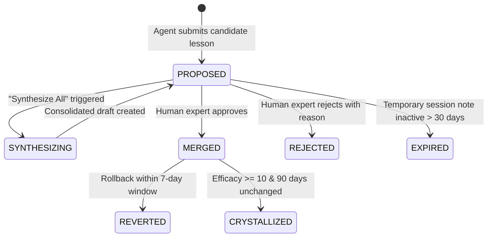

# Module: The Gate (Memory Curation & Proposal Review)

[⬅ Back to Feature Catalog](../../FEATURES.md)

## 1. Screen: The Gate Review Workspace (`/gate`)

### A. Actors & Business Objectives

- **Primary Actors**: Tech Leads, Project Administrators, Curation Agents.
- **Business Goal**: Validate quality of knowledge submitted by AI agents, resolve domain conflicts, prevent duplicate entries, and synthesize atomic lessons into authoritative knowledge crystals.

### B. UI Elements & Business Action Matrix

| UI Element                    | Interaction Type        | Visibility / Conditions              | Business Behavior & Rules                                                                                            |
| :---------------------------- | :---------------------- | :----------------------------------- | :------------------------------------------------------------------------------------------------------------------- |
| **Pending Proposal Queue**    | Card List               | Visible when proposals await review  | Displays submitted candidate lessons with author attribution, targeted scope, taxonomy tags, and summary of changes. |
| **"Synthesize All" Action**   | Primary Action Button   | Enabled when $\ge 2$ proposals exist | Uses semantic clustering to aggregate related proposals into consolidated draft syntheses.                           |
| **"Run Sleep Cycle" Trigger** | Secondary Action Button | Always available                     | Manually triggers the background consolidation cycle, decay evaluation, and garbage collection.                      |
| **Side-by-Side Diff Modal**   | Inspection Dialog       | On clicking "Review & Merge"         | Displays side-by-side comparison between the current approved knowledge baseline and proposed modifications.         |
| **"Approve & Merge" Action**  | Confirmation Button     | Inside Diff Modal                    | Certifies that knowledge meets quality standards; commits revision and increments the node version lineage.          |
| **"Reject Proposal" Action**  | Destructive Button      | On each proposal card                | Flags proposal as rejected; mandates entering a business justification to provide feedback for future iterations.    |
| **Knowledge Evolution Log**   | Vertical Timeline       | Always visible                       | Chronologically traces creation, revision, merge, and rejection history of each knowledge node.                      |
| **"Undo Merge" Action**       | Rollback Button         | Visible within 7-day grace window    | Allows administrators to safely revert an approved merge if defects or conflicts are discovered post-approval.       |

---

## 2. Lifecycle State Machine & Business Rules

### State Transition Matrix

| Initial State | Target State   | Actor / Event        | Pre-conditions (Guards)                           | Business Side Effects                                                                     |
| :------------ | :------------- | :------------------- | :------------------------------------------------ | :---------------------------------------------------------------------------------------- |
| `PROPOSED`    | `MERGED`       | Tech Lead approves   | Must have at least one valid categorization tag   | Node becomes active baseline; version increments; system-wide real-time update broadcast. |
| `PROPOSED`    | `REJECTED`     | Tech Lead rejects    | Rejection reason must be provided                 | Rejection justification recorded in audit log for feedback learning.                      |
| `MERGED`      | `REVERTED`     | Tech Lead rolls back | Action must occur within 7 calendar days          | Restores previous version content; logs rollback event in audit timeline.                 |
| `MERGED`      | `CRYSTALLIZED` | Automated REM Worker | Efficacy count $\ge 10$ and unchanged for 90 days | Promoted to permanent crystal; protected from automated decay and pruning.                |

---

## 3. Proposal Governance & Taxonomy Rules

- **Mandatory Categorization Policy**: Every proposal must declare at least one standardized section category (_Mistakes to Avoid, Optimized Techniques, Specialized Conventions, or User Personas_).
- **Scope Hierarchy**:
  - `GLOBAL`: Universal engineering standard enforced across all repositories.
  - `PROJECT`: Scoped strictly to the specific project boundary matching the repository root.
  - `SESSION`: Ephemeral in-flight observation during a single task.
- **De-duplication Policy**: Submissions matching identical text signatures to active nodes are automatically rejected.
