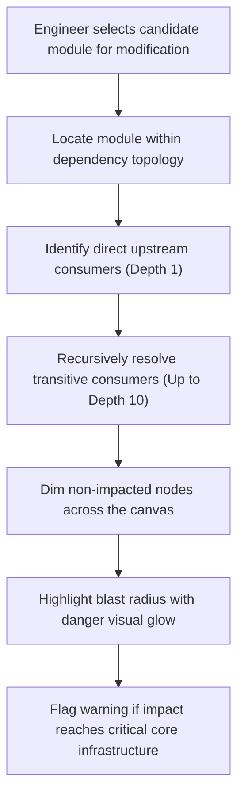

# Module: Dependency Graph Explorer & Codebase Visualizer

[⬅ Back to Feature Catalog](../../FEATURES.md)

## 1. Screen: Dependency Graph Explorer (`/dependency-graph`)

### A. Actors & Business Objectives

- **Primary Actors**: Software Engineers, System Architects, QA Engineers.
- **Business Goal**: Visualize codebase architecture as an interactive relationship network, compute the blast radius of proposed modifications, and detect orphaned components to eliminate technical debt.

### B. UI Elements & Business Action Matrix

| UI Element                   | Interaction Type         | Visibility / Conditions   | Business Behavior & Rules                                                                                                 |
| :--------------------------- | :----------------------- | :------------------------ | :------------------------------------------------------------------------------------------------------------------------ |
| **Repository Selector**      | Dropdown Menu            | Always visible            | Allows switching between indexed project repositories in the workspace.                                                   |
| **Folder Hierarchy Tree**    | Collapsible Tree         | Always visible (Sidebar)  | Reflects directory structure; selecting a directory filters and focuses the canvas on contained modules.                  |
| **Interactive Graph Canvas** | Force Simulation Network | Always visible            | Renders code modules as nodes and dependency imports as directed edges; supports zoom, pan, orbit, and node dragging.     |
| **Blast Radius Panel**       | Inspection Sidebar       | Visible on node selection | Quantifies upstream modules directly or transitively affected if this component is altered, plus downstream dependencies. |
| **Orphan Filter Toggle**     | Switch Button            | Always visible            | Filters canvas to show only disconnected components (zero incoming/outgoing connections) for dead code audits.            |
| **"Sync Repository" CTA**    | Primary Action Button    | Always visible            | Triggers re-indexing of the workspace to capture structural updates and newly added relationships.                        |

---

## 2. Business Workflow: Blast Radius & Impact Analysis

### Business Risk Tiers

1. **Low Risk**: Blast radius $\le 2$ consumer modules; zero impact on data or authentication boundaries.
2. **Medium Risk**: Blast radius between $3$ and $7$ consumer modules.
3. **High Risk (Critical)**: Blast radius $> 7$ consumer modules or touches system core foundations (e.g. database connectors, identity providers). Mandates Tech Lead sign-off and mandatory regression test execution prior to code merging.
