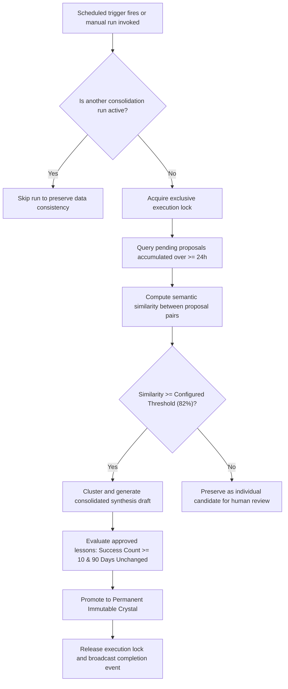

# Service: REM Sleep Cycle Background Worker

[⬅ Back to Feature Catalog](../../FEATURES.md)

## 1. Functional Scope & Business Triggers

| Business Process                   | Trigger Mechanism             | Frequency / Source                           | Concurrency & Execution Guard                           |
| :--------------------------------- | :---------------------------- | :------------------------------------------- | :------------------------------------------------------ |
| **REM Consolidation Cycle**        | Scheduled Background Interval | Periodic (Default: every 10 mins)            | Single-worker operational lock to avoid race conditions |
| **Manual Consolidation Run**       | Human Operator Request        | Operator clicks "Run Sleep Cycle" in Gate UI | Rejected if an active consolidation run is in progress  |
| **Memory Decay & Crystal Pruning** | Nightly System Job            | Daily at 00:00 UTC                           | System-wide transaction boundary                        |

---

## 2. Business Flow & Processing Rules: 24h Sleep Cycle

### Core Business Policies

#### A. Candidate Qualification & Clustering

- Only proposals older than 24 hours qualify for automated clustering, ensuring intra-day active work settles before consolidation.
- Proposals with semantic similarity meeting or exceeding the threshold ($82\%$) are clustered into a unified synthesis draft, eliminating fragmented instructions.

#### B. Permanent Crystal Promotion

- A lesson matures into an authoritative permanent crystal when and only when:
  1. The practical success reuse count reaches 10 or more.
  2. The guideline remains unchanged without disputes for 90 consecutive calendar days.
- Once crystallized, a rule cannot be decayed or removed by automated pruning routines.

#### C. Memory Decay & Garbage Collection

- Ephemeral session notes possessing zero efficacy and unreferenced for 30 consecutive days are automatically purged when Forget Mode is active.
