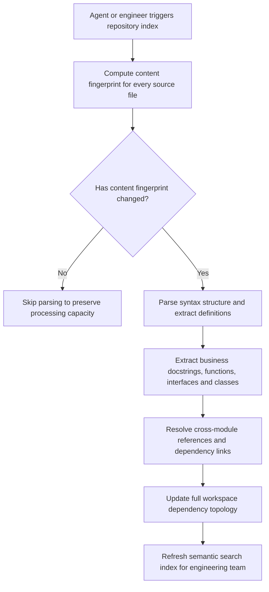

# Service: Codebase Indexer Engine

[⬅ Back to Feature Catalog](../../FEATURES.md)

## 1. Functional Scope & Business Triggers

| Business Capability             | Trigger Actor / Event             | Trigger Condition                                     | Operational Safety Guard                         |
| :------------------------------ | :-------------------------------- | :---------------------------------------------------- | :----------------------------------------------- |
| **Workspace Topology Indexing** | AI Agent Task Execution           | At the start of a coding task on a new repository     | Restricts scope to repository directory boundary |
| **Manual Workspace Resync**     | Engineer clicks "Sync Repository" | Following large merges or major architectural changes | Per-repository lock preventing duplicate scans   |
| **Incremental File Watcher**    | Local Workspace File Event        | When files are saved or modified during development   | 500ms debounce to bundle rapid sequential edits  |

---

## 2. Business Flow: Incremental Structural Extraction

### Business Rules & Extraction Standards

#### A. Incremental Delta Strategy

- Unchanged files are skipped during scanning to preserve system responsiveness.
- References to deleted files are immediately pruned to guarantee that dependency maps reflect current reality without phantom imports.

#### B. Semantic Business Extraction

- In addition to structural relationships, the engine extracts domain docstrings and comments to help AI agents explain underlying business logic rather than pure syntax.
- Modules with excessive inward dependencies are flagged as high-risk architectural bottlenecks.
