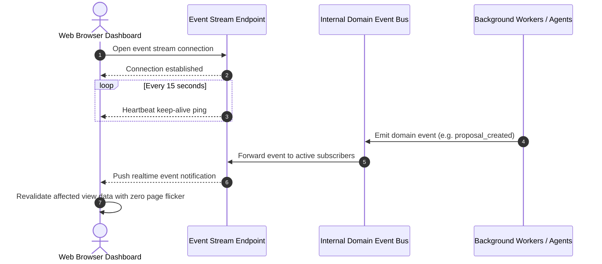

# Service: Realtime Event Pipeline

[⬅ Back to Feature Catalog](../../FEATURES.md)

## 1. Functional Scope & Channel Subscriptions

| Channel / Stream            | Transport Mechanism | Subscribed Consumers               | Connection & Heartbeat Policy        |
| :-------------------------- | :------------------ | :--------------------------------- | :----------------------------------- |
| **System Event Stream**     | Server-Sent Events  | Web UI (Gate, Dashboard, Settings) | Continuous 15s keep-alive ping       |
| **Internal Domain Emitter** | Event Emitter Bus   | Background Workers & Portal Core   | Process-scoped singleton message bus |

---

## 2. Business Event Taxonomy & Side Effects

| Event Name              | Originating Actor / Source | Business Payload Summary                      | Client / Consumer Side Effect                      |
| :---------------------- | :------------------------- | :-------------------------------------------- | :------------------------------------------------- |
| **`proposal_created`**  | Agent via `propose_memory` | New proposal identifier, title, author, scope | Increments pending counter badge in header nav     |
| **`proposal_merged`**   | Expert in The Gate         | Proposal identifier, target node, title       | Updates curation queue and refreshes metrics       |
| **`proposal_rejected`** | Expert in The Gate         | Proposal identifier, rejection justification  | Removes card from active queue without full reload |
| **`indexer_progress`**  | Repository Indexer Engine  | Repository slug, progress percentage          | Advances progress bar on Dependency Graph Explorer |
| **`sleep_cycle_done`**  | REM Sleep Cycle Worker     | Consolidated count, new crystal creations     | Dispatches toast notification on active dashboards |

---

## 3. Communication Sequence & Connection Resilience

- **Reconnection Policy**: If the streaming connection drops due to network fluctuations, clients automatically retry with exponential backoff.
- **Resource Cleanup**: Client disconnections instantly remove listeners from the event bus to prevent resource leakage.
