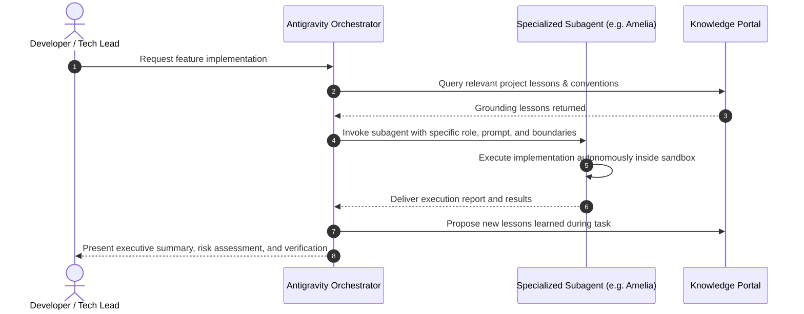

# Module: Multi-Agent Orchestration & Master Skills Suite

[⬅ Back to Feature Catalog](../../FEATURES.md)

## 1. Multi-Agent Roster & Functional Capabilities

| Agent Identifier                | Persona Title                  | Core Domain & Focus Area                  | Key Capabilities & Business Responsibilities                             |
| :------------------------------ | :----------------------------- | :---------------------------------------- | :----------------------------------------------------------------------- |
| **`synapse-agent-analyst`**     | Mary - Business Analyst        | Business strategy & feature decomposition | PRD formulation, acceptance criteria validation, requirement elicitation |
| **`synapse-agent-architect`**   | Winston - System Architect     | Technical architecture & system design    | High-level system design, schema definitions, scalability reviews        |
| **`synapse-agent-creative`**    | Disruptive Innovator           | Radical ideation & concept direction      | Blue ocean strategies, brand narratives, breakthrough product concepts   |
| **`synapse-agent-cto`**         | Arthur - CTO Advisor           | Adversarial review & risk consulting      | Architecture challenge, tech debt audit, security governance             |
| **`synapse-agent-game-dev`**    | Game Systems Engineer          | Interactive gameplay & canvas rendering   | Physics simulation, framerate profiling, shader pipelines                |
| **`synapse-agent-mobile-dev`**  | Mobile Performance Expert      | Mobile application engineering            | Offline-first sync, fluid animations, app store guidelines               |
| **`synapse-agent-pm`**          | John - Product Manager         | Product roadmapping & story formulation   | Epic decomposition, MVP scoping, prioritization matrix                   |
| **`synapse-agent-qa`**          | QA Engineer & White Hat Hacker | Testing, pentesting & compliance          | E2E test suites, security scans, visual regression, threat analysis      |
| **`synapse-agent-tech-writer`** | Paige - Technical Writer       | Living technical documentation & diagrams | Mermaid charts, doc validation, living functional specifications         |
| **`synapse-agent-user`**        | Hana - Global User Advocate    | User empathy & localization strategy      | Cultural nuance analysis, persona simulation, usability feedback         |
| **`synapse-agent-web-dev`**     | Amelia - Fullstack Web Dev     | Fullstack web implementation              | Web application engineering, state management, database integration      |

---

## 2. Master Skills Matrix & Governance

| Skill Suite                         | Canonical Path                                        | Functional Scope & Governance                                                             |
| :---------------------------------- | :---------------------------------------------------- | :---------------------------------------------------------------------------------------- |
| **`synapse-agent-coordination`**    | `synapse-plugin/skills/synapse-agent-coordination`    | Multi-agent conversation orchestration, context budget auditing, prompt elicitation       |
| **`synapse-code-scan`**             | `synapse-plugin/skills/synapse-code-scan`             | Static code quality analysis, container vulnerability scans, configuration hardening      |
| **`synapse-design-suite`**          | `synapse-plugin/skills/synapse-design-suite`          | UX strategy, interface design systems, AI art prompt engineering, copywriting             |
| **`synapse-development-suite`**     | `synapse-plugin/skills/synapse-development-suite`     | Implementation workflows, refactoring, story execution, framework scaffolding             |
| **`synapse-knowledge-suite`**       | `synapse-plugin/skills/synapse-knowledge-suite`       | Long-term memory query/propose, online documentation lookup, AST repository indexer       |
| **`synapse-qa-and-security-suite`** | `synapse-plugin/skills/synapse-qa-and-security-suite` | Test automation, penetration testing, security audit workflows, pull request walkthroughs |

---

## 3. Delegation & Sub-Agent Lifecycle Flow

