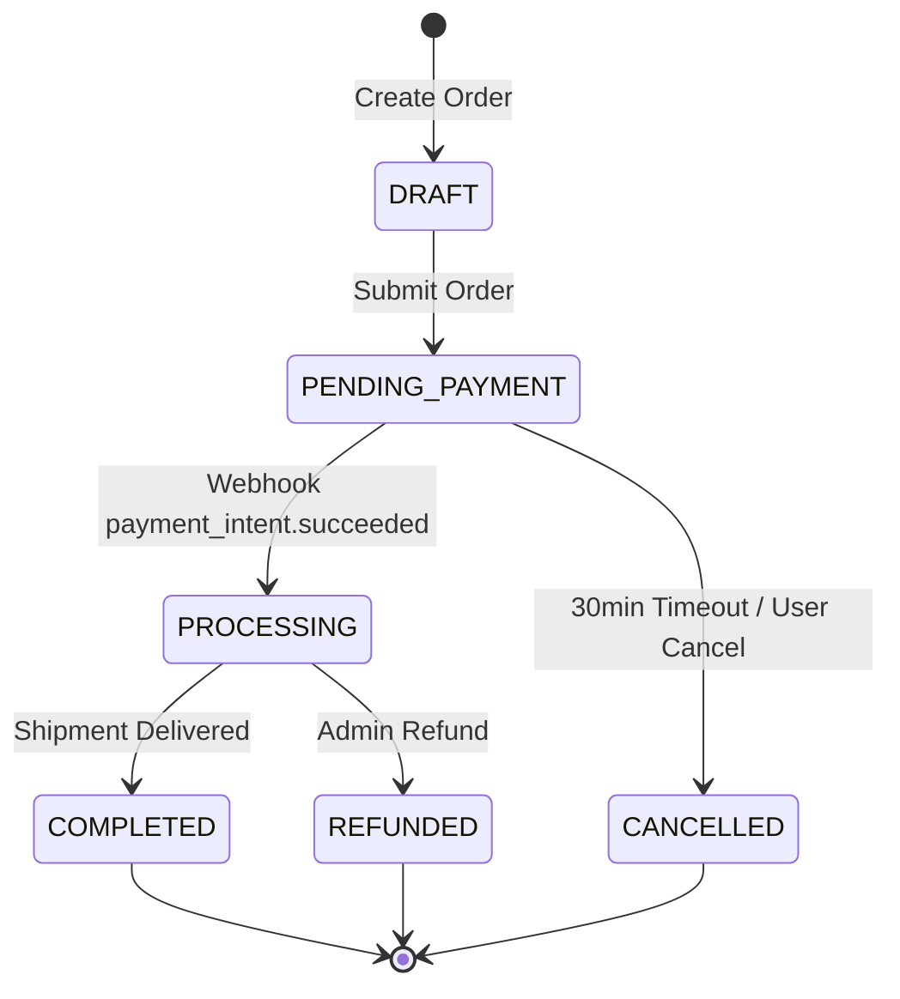

# Feature Specification & Business Flow Guidelines (Fullstack & Background Services)

> [!IMPORTANT]
> **CRITICAL ENFORCEMENT**: Maintaining the living functional specification in `FEATURES.md` and `docs/features/*.md` is **MANDATORY** for any task or feature involving user interfaces (FE), backend APIs, background workers, scheduled cron jobs, queue consumers, webhooks, or event-driven services. Every feature that directly or indirectly impacts **business logic** MUST be documented with high granularity by the AI Agent.

This rule outlines the protocol for generating, modularizing, and updating the project's living Feature & Business Flow Specification across Frontend, Backend, and Background Services.

---

### 1. Distinction from Changelog & Code Implementation

| Document                                 | Nature                                | Purpose                                                                                                                                                                         |
| :--------------------------------------- | :------------------------------------ | :------------------------------------------------------------------------------------------------------------------------------------------------------------------------------ |
| **`CHANGELOG.md`**                       | **Delta / Historical Log**            | Documents _what changed_ in a specific branch/commit compared to `develop`/`main`.                                                                                              |
| **Code / Tech Specs**                    | **Implementation Details**            | Contains language syntax, class names, internal functions, ORM queries, and ephemeral code structures.                                                                          |
| **`FEATURES.md` + `docs/features/*.md`** | **Functional Business Specification** | Documents _how the business operates from a functional perspective_: actors, user intents, business rules, lifecycle state machines, pre/post-conditions, and data constraints. |

---

### 2. Functional Business Specification Principle (CRITICAL)

> [!IMPORTANT]
> **BUSINESS-FIRST, ZERO IMPLEMENTATION COUPLING**:
> Feature specifications must document **Business Capabilities and Logic Rules**, NEVER internal code implementations.
>
> - **FORBIDDEN in Feature Specs**:
>   - Hardcoded code filenames (e.g. `event-service.ts`, `instrumentation.ts`, `page_content.tsx`).
>   - Framework-specific component names (e.g. `TiltCard`, `StatCard`, `OverviewCharts`).
>   - Raw database queries or internal ORM expressions (e.g. `SELECT * FROM orders WHERE...`, `prisma.knowledgeNode.findMany`).
>   - Internal variable names, private methods, or ephemeral library bindings.
> - **MANDATORY Focus**:
>   - **Actors & Goals**: Who initiates the action (e.g. End User, Admin, Automated Scheduler, External Payment Gateway) and what outcome they achieve.
>   - **Business Rules & Validation Policies**: Exact constraints (e.g. "Proposals must contain at least one categorization tag", "Cluster threshold $\ge 82\%$", "Account locked after 5 failed attempts within 15 minutes").
>   - **Functional State Transitions**: Clear lifecycle states (e.g. `PENDING` -> `APPROVED` -> `CRYSTALLIZED`).
>   - **Pre-conditions & Post-conditions**: Requirements before execution and business side effects upon completion (e.g. "Restores inventory stock and notifies customer via email").
>   - **Business Fallbacks & Edge Cases**: What happens on failure or conflict from a business standpoint.

---

### 2. Architecture & File Placement (Hub-and-Spoke)

Depending on the workspace and repository topology (Monorepo vs. Multi-repo), the placement of `FEATURES.md` and `docs/features/` is defined as follows:

#### A. Multi-Repo Architecture (e.g., `project-fe/`, `project-be/`)

When the project is split into independent Git repositories for frontend and backend (each having its own `.git` directory) located within the same root workspace:

- **Centralize specifications in `*-docs` (or `project-docs/`) co-located alongside the FE and BE repositories**: All business logic, end-to-end flows, UI matrices, and API contracts MUST be managed centrally within this dedicated shared documentation directory to prevent duplicate documentation across individual repos.
- Directory Structure:

```text
<workspace-root>/
├── project-fe/                       # Frontend Git repository (independent .git)
├── project-be/                       # Backend Git repository (independent .git)
└── project-docs/                     # Central documentation repository or directory
    ├── FEATURES.md                   # Master Index: High-level overview & Module Table of Contents
    └── docs/
        └── features/                 # Detailed modular specifications
            ├── 01-authentication.md  # Combined UI + Auth API + Session Lifecycle
            ├── 02-order-management.md# Combined UI Checkout + Order APIs + Webhooks
            └── ...
```

#### B. Monorepo Architecture (Single `.git` Root)

When frontend, backend, and background packages reside within a single unified Git repository (only one `.git` directory at the root level):

- Place `FEATURES.md` and `docs/features/` directly at the repository root co-located with `.git`:

```text
<repository-git-root>/
├── .git/
├── apps/ (or frontend/, backend/)
├── FEATURES.md                       # Master Index co-located with .git
└── docs/
    └── features/                     # Detailed modular specifications
        ├── 01-authentication.md
        ├── 02-order-management.md
        └── ...
```

---

### 3. Strict Relative Path Rule (CRITICAL)

- **Relative Paths ONLY**: All internal links between `FEATURES.md` and `docs/features/*.md` MUST use relative paths (e.g., `[Billing Worker](./docs/features/03-billing-worker.md)` or `[⬅ Back to Catalog](../../FEATURES.md)`).
- **Absolute Paths Prohibited**: NEVER write absolute file paths (such as `/Users/...`, `C:\...`, or `file:///...`) into any markdown or repository files.

---

### 4. Master Index Format (`FEATURES.md`)

The root `FEATURES.md` categorizes both User-Facing (FE) and Background/Core (BE/Worker) capabilities:

```markdown
# Product Feature Catalog & Business Flow Specifications

> Comprehensive functional specification and living flow documentation for [Project Name].

## 📌 Module Index

### 🖥️ User-Facing & Frontend Modules

| Module                    | Scope & Capabilities                                        | Status   | Detailed Specification                                                       |
| :------------------------ | :---------------------------------------------------------- | :------- | :--------------------------------------------------------------------------- |
| **01. Authentication**    | Login/Register UI, OAuth2, 2FA Modal, Password Reset        | `Stable` | [docs/features/01-authentication.md](./docs/features/01-authentication.md)   |
| **02. Orders & Checkout** | Cart Drawer, Voucher Engine, Stripe Elements, Order History | `Stable` | [docs/features/02-orders-checkout.md](./docs/features/02-orders-checkout.md) |

### ⚙️ Backend, Workers & Background Services

| Service / Worker           | Trigger & Execution Scope                                        | Status   | Detailed Specification                                                             |
| :------------------------- | :--------------------------------------------------------------- | :------- | :--------------------------------------------------------------------------------- |
| **03. Billing Worker**     | Cron (0 0 1 \* \*), Auto-generate monthly invoices & charge card | `Stable` | [docs/features/03-billing-worker.md](./docs/features/03-billing-worker.md)         |
| **04. Order Expiry Queue** | Redis Delay Queue (30 mins), Auto-cancels unpaid orders          | `Stable` | [docs/features/04-order-expiry-queue.md](./docs/features/04-order-expiry-queue.md) |
| **05. Payment Webhooks**   | Stripe `payment_intent.succeeded` event listener & state sync    | `Stable` | [docs/features/05-payment-webhooks.md](./docs/features/05-payment-webhooks.md)     |

### 📊 Data Processing, Storage & Cross-Cutting Specifications

| Area / Module             | Scope & Governance Coverage                                   | Status   | Detailed Specification                                                   |
| :------------------------ | :------------------------------------------------------------ | :------- | :----------------------------------------------------------------------- |
| **06. Order Data Import** | Excel/CSV batch import, row validation & field transformation | `Stable` | [docs/features/06-order-import.md](./docs/features/06-order-import.md)   |
| **07. RBAC & Security**   | Role permissions, Multi-tenant scoping & API rate limits      | `Stable` | [docs/features/07-rbac-security.md](./docs/features/07-rbac-security.md) |
| **08. Asset Storage**     | S3 pre-signed upload, CDN caching & async virus inspection    | `Stable` | [docs/features/08-asset-storage.md](./docs/features/08-asset-storage.md) |
```

---

### 5. Detailed Module Specification Formats

#### A. Format for Frontend / UI-Driven Modules (`docs/features/<fe-module>.md`)

```markdown
# Module: [UI Module Name]

[⬅ Back to Feature Catalog](../../FEATURES.md)

## 1. Screen: [Screen Name] (`/route-path`)

### A. UI Elements & Action Matrix

| Element Name          | Component Type | Visibility / Enabled Conditions | Interaction & Business Flow                                                                                                  |
| :-------------------- | :------------- | :------------------------------ | :--------------------------------------------------------------------------------------------------------------------------- |
| **Email Input**       | Input Field    | Always visible                  | Validates email format on blur (`^.+@.+\..+$`). Displays error badge if invalid.                                             |
| **"Sign In" Button**  | Primary Button | Enabled when form is valid      | Calls `POST /api/v1/auth/login`. Displays loading spinner. Redirects to `/dashboard` on success; shows alert toast on error. |
| **"Forgot Password"** | Text Link      | Always visible                  | Opens Modal `#modal-forgot-password` (see Flow 1.2).                                                                         |

### B. Business & User Flows

#### Flow 1.1: Primary Action Flow (Happy Path)

1. User enters credentials and clicks **"Sign In"**.
2. System receives token -> Checks `profile_completed`. If false -> Redirects to `/onboarding`.

#### Flow 1.2: Edge Cases & Error Handling

- **Account Locked**: If failed attempts > 5 in 15 mins, disables submission button for 15 mins with countdown timer.
```

---

#### B. Format for Backend, Worker & Background Service Modules (`docs/features/<be-worker-module>.md`)

```markdown
# Service / Worker: [Service Name]

[⬅ Back to Feature Catalog](../../FEATURES.md)

## 1. Functional Scope & Business Triggers

| Process / Capability               | Business Trigger            | Frequency / Event Source                  | Concurrency & Business Guard                       |
| :--------------------------------- | :-------------------------- | :---------------------------------------- | :------------------------------------------------- |
| **Auto-Cancel Unpaid Orders**      | Payment timeout exceeded    | Every 5 mins / System schedule            | Prevents concurrent cancellation on the same order |
| **Nightly Billing & Invoice Run**  | Accounting closing schedule | Daily at 02:00 UTC                        | Single active run per billing cycle                |
| **Payment Status Synchronization** | External payment confirmed  | Webhook event: `payment_intent.succeeded` | Idempotent: Ignore duplicate transaction events    |

---

## 2. Business Flow & Processing Rules

### Process: [Process Name]

#### A. Pre-conditions & Candidate Qualification

- **Qualification Criteria**: Orders in status `PENDING_PAYMENT` where creation timestamp is older than 30 minutes without confirmed transaction.
- **Batching & Throughput**: Processes in slices of 500 records to prevent business processing bottlenecks.
- **Transaction Boundary**: Atomic per order (failure on one order does not prevent processing others).

#### B. Step-by-Step Functional Workflow

1. **Identify Qualified Candidates**: Retrieve unpaid orders exceeding the timeout window.
2. **Transition Order Lifecycle**: Update status from `PENDING_PAYMENT` to `CANCELLED` with explicit business reason `PAYMENT_TIMEOUT`.
3. **Restock Inventory**: Restore reserved stock back to active warehouse availability for each line item.
4. **Notify Customer**: Dispatch cancellation summary to customer communication channel.

#### C. Business Side Effects & Cross-Domain Notifications

- **Audit Trail**: Append cancellation record to customer order history.
- **Warehouse Operations**: Trigger stock replenishment notification.
- **Customer Relationship**: Alert account manager if high-tier enterprise order cancels.

#### D. Resilience, Fallback & Exception Scenarios

- **Idempotency Guarantee**: Submitting multiple cancellation signals for the same order must yield a neutral success without double restocking.
- **Retry & Recovery**: Retry transient communication errors up to 3 times before escalating to operational review queue.
```

---

#### C. Format for Data Processing, Import & Export Modules (`docs/features/<import-export-module>.md`)

```markdown
# Module: [Data Import / Export Service Name]

[⬅ Back to Feature Catalog](../../FEATURES.md)

## 1. Overview & Constraints

- **File Types Supported**: `.xlsx`, `.csv` (Max size: 25MB).
- **Processing Mode**: Asynchronous via BullMQ/Celery worker (Background job with progress polling via SSE/WebSocket).
- **Upsert / Duplicate Strategy**: Match by `customer_email` + `order_code`. If exists -> `UPDATE`, else -> `INSERT`.

---

## 2. Data Mapping & Transformation Matrix

### A. Import Specification (File to Database Mapping)

| Source Column / Header       | Target DB Field             | Target Type    | Required | Parsing, Validation & Transformation Logic                                 | Fallback / Default Value      |
| :--------------------------- | :-------------------------- | :------------- | :------- | :------------------------------------------------------------------------- | :---------------------------- |
| **`Order Code`** (Col A)     | `orders.order_code`         | `VARCHAR(64)`  | Yes      | Trim whitespace, uppercase. Regex: `^ORD-[0-9]{8}$`.                       | Reject record if invalid      |
| **`Customer Email`** (Col B) | `users.email`               | `VARCHAR(255)` | Yes      | Lowercase, trim. Validate email regex. Check existing user ID.             | Reject record if invalid      |
| **`Order Date`** (Col C)     | `orders.ordered_at`         | `TIMESTAMP`    | No       | Parse format `DD/MM/YYYY HH:mm`. Convert timezone to UTC.                  | Fallback: `CURRENT_TIMESTAMP` |
| **`Item Total`** (Col D)     | `orders.total_amount_cents` | `BIGINT`       | Yes      | Parse currency string, multiply by 100, round to integer. Reject if `< 0`. | Reject record if invalid      |
| **`Notes`** (Col E)          | `orders.customer_notes`     | `TEXT`         | No       | Sanitize HTML entities, truncate to 500 chars.                             | Fallback: `NULL`              |

### B. Export Specification (Database to File Mapping)

| Output Header Name    | Source Entity / Query Expression  | Formatting & Serialization Rules                                     |
| :-------------------- | :-------------------------------- | :------------------------------------------------------------------- | --- | --- | ---------------- | ------------------------ |
| **`Mã đơn hàng`**     | `orders.order_code`               | Raw string                                                           |
| **`Khách hàng`**      | `users.first_name                 |                                                                      | ' ' |     | users.last_name` | Title case concatenation |
| **`Trạng thái`**      | `orders.status`                   | Enum mapping: `PAID` -> `"Đã thanh toán"`, `CANCELLED` -> `"Đã hủy"` |
| **`Tổng tiền (VND)`** | `orders.total_amount_cents / 100` | Number format: `#,##0`                                               |
| **`Ngày tạo`**        | `orders.created_at`               | Format string: `YYYY-MM-DD HH:mm:ss` (Local timezone GMT+7)          |

---

## 3. Error Handling & Partial Failure Strategy

- **Row-Level Validation**: Collect all row errors and export an error report file (`error_rows_download.xlsx`) with an appended `Error Details` column.
- **Transaction Rollback Policy**: Partial commit allowed (`skip_and_log_error`), unless `all_or_nothing = true` flag is passed in request.
```

---

#### D. Format for Integration, Webhooks & State Machines (`docs/features/<integration-state-module>.md`)

````markdown
# Module: [Integration / State Machine Name]

[⬅ Back to Feature Catalog](../../FEATURES.md)

## 1. State Machine Definition (Lifecycle & Transitions)


````

### State Transition Matrix

| From State        | To State          | Trigger Event / Actor   | Guard / Pre-condition           | Side Effects & Mutations              |
| :---------------- | :---------------- | :---------------------- | :------------------------------ | :------------------------------------ |
| `DRAFT`           | `PENDING_PAYMENT` | User clicks Checkout    | Cart has items, stock > 0       | Lock inventory, create payment intent |
| `PENDING_PAYMENT` | `PROCESSING`      | Stripe Webhook Callback | Valid signature, amount matches | Mark order paid, notify warehouse     |
| `PENDING_PAYMENT` | `CANCELLED`       | Expiry Worker / User    | Order not yet paid              | Release stock, send cancel email      |

---

## 2. Inbound & Outbound Webhook Contracts

- **Webhook Provider**: Stripe / Third-Party Logistics
- **Signature Verification**: HMAC-SHA256 with header `Stripe-Signature` and webhook signing secret.
- **Idempotency Guarantee**: Event ID stored in `processed_webhook_events(event_id)` table with `UNIQUE` constraint. Returns HTTP 200 immediately if event was already processed.
- **Payload Schema & Field Mapping**:
  - `payload.data.object.id` -> `orders.payment_intent_id`
  - `payload.data.object.amount_received` -> verify matches `orders.total_amount_cents`

````

---

#### E. Format for Access Control, Rate Limiting & Multi-Tenancy (`docs/features/<rbac-security-module>.md`)

```markdown
# Security & Access Control: [Module / Domain Name]

[⬅ Back to Feature Catalog](../../FEATURES.md)

## 1. Role-Based Access Control (RBAC) & Permission Matrix

| Endpoint / Action | Allowed Roles | Required Permissions / Scopes | Tenant Scoping Rule | Unauthorized Behavior |
| :--- | :--- | :--- | :--- | :--- |
| `GET /api/v1/orders` | `Owner`, `Admin`, `Support` | `orders:read` | Scoped to caller's `org_id` | HTTP 403 Forbidden |
| `POST /api/v1/orders/:id/refund` | `Owner`, `Admin` | `orders:refund` | Scoped to caller's `org_id` | HTTP 403 Forbidden |
| `GET /api/v1/users/export` | `Owner` | `users:export`, `mfa_verified` | Scoped to caller's `org_id` | HTTP 403 (Requires active MFA) |

## 2. Rate Limiting, Quotas & Throttling
- **Public / Auth Endpoints** (e.g. `POST /api/v1/auth/login`, `POST /api/v1/auth/otp`):
  - Threshold: Max 5 requests per 60 seconds per IP + Username tuple.
  - Exceeded Response: HTTP 429 Too Many Requests (`Retry-After: 60`).
- **Heavy / Bulk Processing** (e.g. Export / Batch Reports):
  - Threshold: Max 2 concurrent export jobs per organization.
  - Cooldown: 1 request every 5 minutes per user.
````

---

#### F. Format for Media, File Storage & CDN Lifecycle (`docs/features/<storage-assets-module>.md`)

```markdown
# Storage & Media Assets: [Module Name]

[⬅ Back to Feature Catalog](../../FEATURES.md)

## 1. Upload Flow & Lifecycle Matrix

| Asset Category        | Max Size | Allowed MIME Types                      | Storage Target (S3/GCS/Local)         | Pre-signed URL / Direct?            | CDN / Retention Policy                       |
| :-------------------- | :------- | :-------------------------------------- | :------------------------------------ | :---------------------------------- | :------------------------------------------- |
| **User Avatar**       | 2MB      | `image/jpeg`, `image/png`, `image/webp` | `s3://app-assets/avatars/{user_id}/`  | Direct Pre-signed PUT (Expires: 5m) | Public CloudFront, Cache 30d                 |
| **Invoice PDF**       | 10MB     | `application/pdf`                       | `s3://app-private/invoices/{org_id}/` | Server-generated & piped            | Private S3, Pre-signed GET (Expires: 15m)    |
| **Temporary Exports** | 50MB     | `application/vnd.openxmlformats`        | `s3://app-temp/exports/{uuid}.xlsx`   | Worker upload via IAM role          | Auto-delete via S3 Lifecycle rule (TTL: 24h) |

## 2. Virus Scanning & Async Post-Processing

- **Scan Trigger**: S3 `ObjectCreated:*` event triggers Lambda / ClamAV container.
- **Image Variants**: Auto-generate thumbnails (128x128, 512x512 webp) via background worker before updating `users.avatar_url`.
```

---

### 6. AI Agent Lifecycle & Maintenance Rules

1. **Fullstack Scope Awareness**:
   - Do NOT restrict feature docs to visible UI. Whenever building or modifying background jobs, cron tasks, event listeners, webhooks, or API controllers, verify their business impact and document them in `docs/features/`.
2. **New Feature Implementation**:
   - Locate or create the corresponding `docs/features/<module>.md` (UI or Worker/Service).
   - Detail triggers, action matrices, step-by-step execution flows, side effects, and error handling.
   - Register the module in `FEATURES.md` using relative links.
3. **Feature Modification / Refactoring**:
   - If UI elements, API behavior, cron schedule, retry policy, or business logic changes, update the corresponding file in `docs/features/*.md` immediately.
4. **Feature Deprecation / Removal**:
   - Remove or mark deprecated background jobs and UI flows to ensure the specification remains the Single Source of Truth.

---

### 7. Cold Start & Legacy Project Adoption Protocol

When working on an existing or legacy repository where `FEATURES.md` does not yet exist, agents MUST follow this protocol:

1. **Default Mode: Incremental Adoption (Task-Scoped)**:
   - Do NOT perform an uncontrolled scan of the entire legacy codebase during normal feature/fix tasks (to avoid context overflow and hallucination).
   - **Step A**: Initialize the root `FEATURES.md` index template at the `.git` root.
   - **Step B**: Create `docs/features/<module>.md` specifically for the module, UI screen, or background worker touched by the current task.
   - **Step C**: Register that module into `FEATURES.md`. Unmodified legacy modules will be adopted incrementally as future tasks interact with them.
2. **Explicit Baseline Scan Mode (On User Request)**:
   - When the user explicitly requests to initialize or reverse-engineer the complete feature catalog for a legacy project:
     - Scan routing files, API controllers, page directories, and background job definitions to construct the comprehensive module index in `FEATURES.md`.
     - Prioritize generating granular `docs/features/*.md` specifications for core authentication and primary business workflows first.
